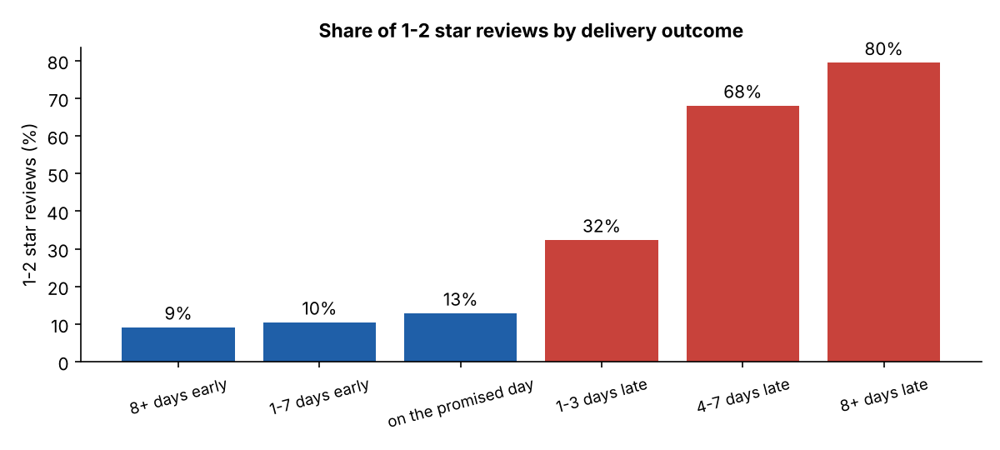
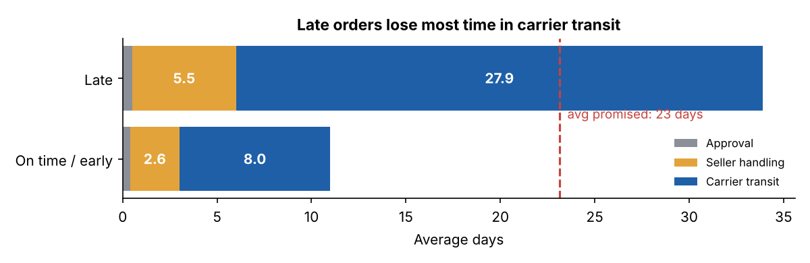
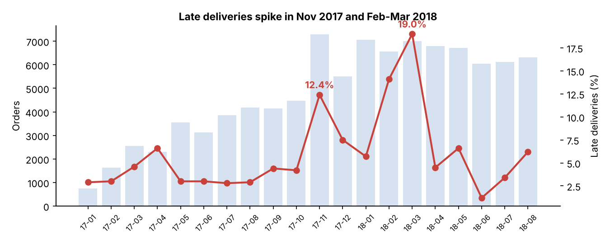
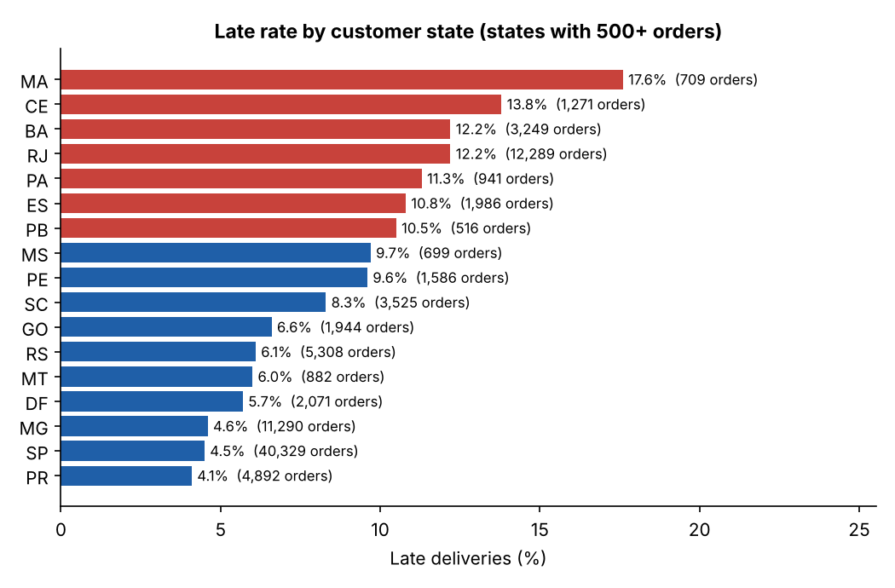

# Late Deliveries Cost Olist Its Best Reviews

**Delivery performance, customer satisfaction and data quality for ~96,000 e-commerce orders**

**[Open the interactive dashboard](https://manjusree-prog.github.io/olist-delivery-analytics/)**

SQL (SQLite: CTEs, window functions) · Python (pandas, SciPy, Matplotlib) · Data quality checks · Dashboard (HTML/SVG) · Power BI data model

---

## The business question

Olist is a Brazilian online marketplace that connects small sellers with customers. Sellers ship through carriers, and every customer gets a promised delivery date at checkout.

I wanted to answer three questions a delivery or customer-experience manager would ask:

1. **How often do we miss the promised delivery date, and does it really hurt customer satisfaction?**
2. **Where does the delay happen:** at the seller, at the carrier, or in specific regions?
3. **What should we fix first?**

## Data

[Brazilian E-Commerce Public Dataset by Olist](https://www.kaggle.com/datasets/olistbr/brazilian-ecommerce) (Kaggle, CC BY-NC-SA 4.0): 99,441 orders from 2016 to 2018 across 8 related tables (orders, items, payments, reviews, customers, sellers, products, category names).

I analysed delivered orders purchased between **January 2017 and August 2018**. The months before and after that have too few orders to be reliable.

## Approach

```
raw CSVs ──► SQLite ──► data quality checks ──► clean fact table ──► KPI queries (SQL) ──► statistics + charts (Python) ──► dashboard
                              │
                              └──► quarantine table (failing rows kept with a reason)
```

1. **Load** the 8 CSV files into SQLite and index the join keys ([`scripts/load_to_sqlite.py`](scripts/load_to_sqlite.py)).
2. **Check data quality before trusting anything** ([`sql/02_clean_layer.sql`](sql/02_clean_layer.sql), [`sql/03_data_quality_checks.sql`](sql/03_data_quality_checks.sql)). Every delivered order is tested for impossible or missing timestamps. Failing orders go to a `dq_quarantine` table with the reason instead of being deleted silently.
3. **Calculate KPIs in SQL** ([`sql/04_kpis.sql`](sql/04_kpis.sql)): monthly trend with a 3-month rolling late rate, reviews by delivery outcome, late rate by state with `RANK()`, delivery-stage breakdown, cumulative seller share of late orders, category performance, and repeat purchases.
4. **Test whether the differences are real** and draw the charts ([`scripts/analysis.py`](scripts/analysis.py)).
5. **Build the dashboard** ([`docs/index.html`](docs/index.html)) and export a star-schema model for Power BI ([`powerbi/`](powerbi/)).

## Data quality findings

| Check | Failing rows | What I did |
|---|---:|---|
| Delivered status but no delivery date | 8 | Quarantined |
| Handed to carrier *before* the purchase | 165 | Quarantined |
| Delivered to customer before carrier handover | 23 | Quarantined |
| Missing approval / carrier timestamp | 15 | Quarantined |
| Payment total differs from items + freight by more than R$1 | 249 | Kept; analysis uses item + freight values |
| Orders with more than one review | 555 | Kept the latest review per order |
| Products without a category | 610 | Labelled "unknown" |

**99,441 orders → 96,478 delivered → 211 quarantined → 96,267 clean orders.** Only 0.2% of delivered orders failed, so the data is usable, but the timestamp errors would have distorted the delivery-time averages if I hadn't removed them.

## Key findings

### 1. 6.8% of orders arrive late, and those customers stop being happy
Of 96,004 delivered orders, **6,528 (6.8%) arrived after the promised date**.

- Average review: **2.25 for late orders vs 4.28** for on-time orders.
- 1–2 star reviews: **62.9% for late orders vs 9.5%** for on-time orders. For orders 8+ days late it is **79.5%**.
- The difference is statistically significant (Mann-Whitney U test, p < 0.001).



As a rough estimate, if late orders had been reviewed like on-time orders, Olist would have received about **3,500 fewer 1–2 star reviews** in this period.

### 2. The delay happens in carrier transit, not at the seller
| Stage (average days) | On time / early | Late |
|---|---:|---:|
| Payment approval | 0.4 | 0.5 |
| Seller handling (approval → carrier) | 2.6 | 5.5 |
| **Carrier transit (carrier → customer)** | **8.0** | **27.9** |
| Total | 11.0 | 33.9 |

Late orders are about 3 days slower at the seller, but **20 days slower in transit**. The promised date (about 23 days on average) is already generous, so the main issue is the delivery network.



### 3. Two clear peaks: Black Friday and February–March 2018
Outside the peaks the late rate stayed between 1% and 7%, but it rose to **12.4% in November 2017** (Black Friday) and **14.1% / 19.0% in February / March 2018**, while order volume stayed about the same.



### 4. Rio de Janeiro and the Northeast are the problem regions
- Late rates are highest in **MA (17.6%), CE (13.8%), BA and RJ (12.2%)**, compared with **SP at 4.5%**.
- **RJ matters most because of volume:** 12.8% of orders, but **23% of all late orders** (1,499).



### 5. Sellers: mostly a volume effect, plus a small watch-list
- The top 10% of sellers account for 74% of late orders, but they also handle 63% of all orders. Late orders mostly follow volume.
- However, **37 sellers (1.3%) with 30+ orders run at an 18.7% late rate**, almost 3x the average ([`outputs/seller_watchlist.csv`](outputs/seller_watchlist.csv)).

### 6. Repeat purchases are low overall
Customers whose first order arrived late came back slightly less often (**2.52% vs 3.04%**, p = 0.02). The effect is small because very few Olist customers buy twice at all.

## Recommendations

1. **Review carrier performance on the RJ and Northeast lanes first.** That is where most delay time and most late orders are.
2. **Set promised dates per state**, based on each region's real delivery-time distribution, instead of one generous promise that still fails in MA, CE and BA.
3. **Plan peak capacity** before Black Friday and track the 3-month rolling late rate weekly as an early warning.
4. **Put the 37 watch-list sellers on a handling-time target** (for example, hand over to the carrier within 5 days).
5. **Contact customers proactively** when a delay is expected. Reviews collapse once an order is late, so even a message plus a small voucher could protect ratings.

## Limitations

- Orders still in transit when the data was exported are not included, so late rates for the last months are slightly understated.
- The analysis shows strong associations between lateness and bad reviews, not proven causation. A review can also be negative because of the product itself.
- The impact estimate (about 3,500 fewer negative reviews) is a simple what-if, not a forecast.

## Repository structure

```
├── sql/
│   ├── 01_views.sql               # order-level helper views (items, payments, latest review)
│   ├── 02_clean_layer.sql         # data quality flags, quarantine table, clean fact table
│   ├── 03_data_quality_checks.sql # data quality summary
│   └── 04_kpis.sql                # business KPIs (CTEs, window functions)
├── scripts/
│   ├── load_to_sqlite.py          # CSV → SQLite
│   ├── run_sql.py                 # runs named SQL queries → outputs/sql_results/*.csv
│   ├── analysis.py                # statistics, charts, dashboard data, Power BI export
│   └── build_dashboard.py         # builds docs/index.html
├── outputs/
│   ├── sql_results/               # every query result as CSV
│   ├── figures/                   # charts used in this README
│   ├── key_numbers.json
│   └── seller_watchlist.csv
├── dashboard/template.html        # dashboard source
├── docs/index.html                # published dashboard (GitHub Pages)
└── powerbi/                       # star-schema export + DAX measures for Power BI
```

## How to run it

```bash
pip install -r requirements.txt
# download the dataset from Kaggle and put the CSV files in data/raw/
python scripts/load_to_sqlite.py
python scripts/run_sql.py
python scripts/analysis.py
python scripts/build_dashboard.py
```

Everything runs in a few seconds on a laptop.

---

**Teja Manjusree Koduru** · [Portfolio](https://manjusree-prog.github.io) · [LinkedIn](https://www.linkedin.com/in/teja-manjusree-25856b138)
